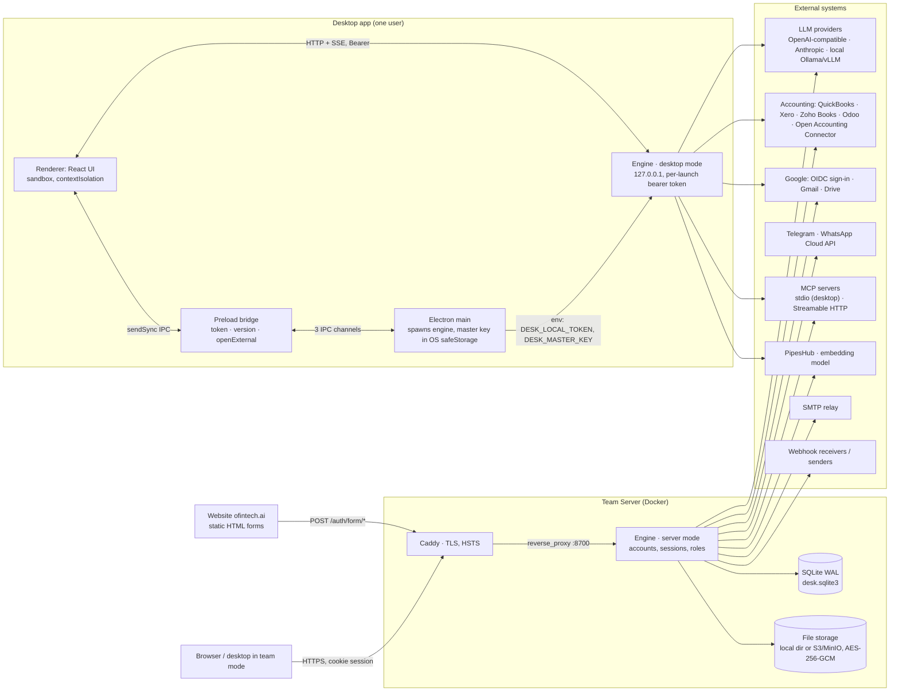
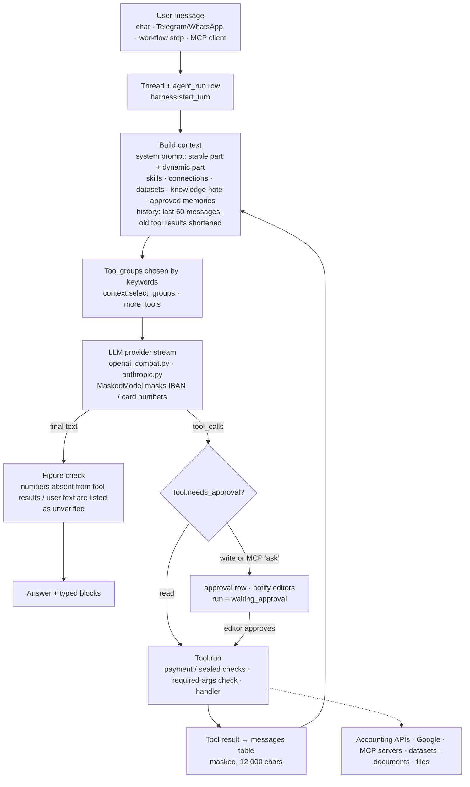
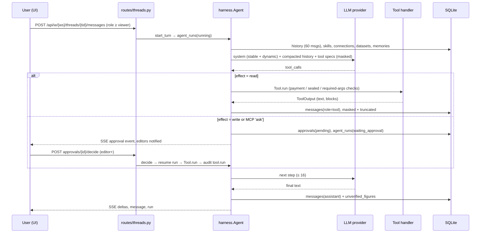
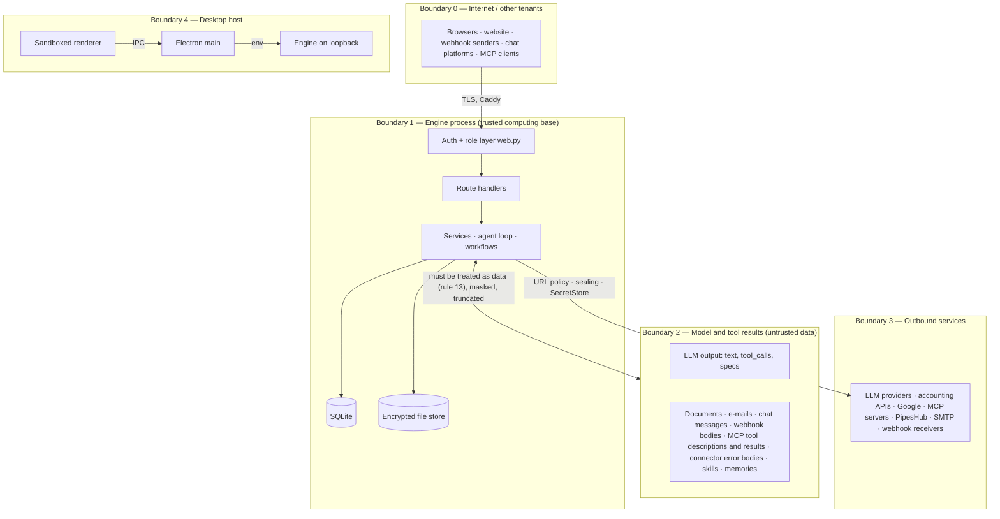

# 01 — Architecture baseline

Engineering and security audit of OfinTech Desk, step 1 of 10. This document records the architecture **as found**
in the repository at commit `e8de370` (1 November 2026, release 1.1.0), before any change was made. Later documents
in this folder build on it: `02-SECURITY-AUDIT.md` holds the findings with evidence, `03-THREAT-MODEL.md` the attack
surface, `08-REMEDIATION-ROADMAP.md` the plan.

Method: every source file under `engine/desk_engine`, `desktop/src`, `ui/src/lib`, `server/`, `landing/`,
`.github/workflows` and `e2e/` was read; the engine test suite was run; a handful of behaviours were checked with
local, non-destructive probes against a throw-away engine instance. Nothing was run against a live system.
Observations in section 10 are classified as *confirmed* (read in code and reproduced or verified by inspection
of the exact lines) or *potential* (depends on configuration or on behaviour not yet exercised). None is a formal
finding yet; those come in document 02 with severity, scenario and tests.

## 1. What the product is

OfinTech Desk is an AI workspace for finance and accounting teams: a chat assistant with finance tools, read-only
connectors to accounting systems (QuickBooks Online, Zoho Books, Xero, Odoo, and an open pull/push connector),
document search (RAG), evidence-linked Excel/Word output, cost centres, KPI analysis and forecasting, a month-end
close, workflows, and messaging channels (Telegram, WhatsApp). Any OpenAI-compatible or Anthropic model can be
used. It ships in two forms built from one engine:

- **Desktop app** — Electron shell + bundled Python engine on `127.0.0.1`, one local user, data under the user's
  profile. Can instead act as a thin client of a Team Server.
- **Team Server** — the same engine in `server` mode in Docker behind Caddy: accounts, workspaces, roles,
  invitations, public webhooks, optional S3/MinIO file storage.

Size: ~49,500 lines excluding generated files and translations (engine ~30k Python, UI ~12k TypeScript/React,
desktop ~0.5k, tests ~6k). 198 authenticated API routes plus 10 public ones. 182 engine tests.

## 2. Repository layout

| Path | Contents |
|---|---|
| `engine/desk_engine/` | Python 3.11+ engine (Starlette + uvicorn). Entry: `__main__.py` → `app.create_app` |
| `engine/desk_engine/routes/` | 19 route modules; `web.py` is the routing/auth layer they share |
| `engine/desk_engine/agent/` | tool registry, agent loop (`harness.py`), context/prompt builders, tool modules |
| `engine/desk_engine/{llm,connectors,knowledge,files,data,costcentres,analysis,close,workflows,channels,skills}/` | domain packages |
| `engine/desk_engine/{db,security,storage,egress,memory,webhooks,mail,mcp_client,mcp_server,events,config}.py` | cross-cutting services |
| `engine/tests/` | unittest suite with a scripted fake LLM and mocked HTTP transports |
| `engine/packaging/` | PyInstaller build of the engine for the desktop app |
| `ui/` | React 19 + esbuild single-page app, hash routing, custom Markdown renderer, 4 languages |
| `desktop/` | Electron main (`main.ts`) and preload (`preload.ts`); electron-builder configs |
| `server/` | Dockerfile, Compose files (plain, MinIO, AIStor, sealed), Caddyfile, backup script |
| `landing/` | static marketing site (nginx, no JavaScript) with sign-in/sign-up forms posting to the Team Server |
| `docs/` | 23 product documents incl. `ARCHITECTURE.md`, `SECURITY.md`, `DATA_BOUNDARIES.md`, `DEPLOYMENT.md` |
| `e2e/` | Playwright browser smoke test driven by a fake LLM server |
| `.github/workflows/` | `build.yml` (test → desktop installers → release → server image), `desktop-cloud.yml` |

## 3. Current architecture

The engine is a **single process**: one asyncio event loop, SQLite through one connection per thread, an
in-process event hub for streaming, in-memory rate limiters, in-process agent and workflow tasks, and a 3-second
scheduler loop (`app.py:123-142`). Nothing is shared between processes, so a deployment is exactly one engine
container (see §9, technical debt).

## 4. Components and responsibilities

### 4.1 Engine HTTP layer

- `app.py` — wires every service into one `Engine` object (`Engine.__init__`), applies migrations and recovers
  interrupted runs on start (`bootstrap`), starts the scheduler, and defines the ASGI app with one middleware,
  `SecurityHeaders` (strict CSP, `nosniff`, `frame-ancestors 'none'`, HSTS when the public URL is https; refuses
  non-loopback `Host` headers in desktop mode as a DNS-rebinding guard). Serves the built UI as static files with a
  path-containment check (`_ui_handler`).
- `web.py` — `Router` decorator: authenticates (`authenticate`), loads the workspace and checks the member's role
  (`load_workspace` → `Ctx.require`), validates the JSON body with pydantic (2 MB cap), converts `AppError` to JSON,
  hides other exceptions behind a generic 500. Roles: `viewer < editor < admin < owner`.
- `routes/*.py` — 198 routes; every workspace route is declared with a minimum role (`role=`), so authorisation is
  declarative and server-side. 10 public routes (`routes/public.py`) authenticate by other means: OAuth state,
  Telegram secret header, WhatsApp HMAC, ingest key, webhook secret or HMAC, or the website's Origin.

### 4.2 Identity, sessions, tenancy

- Desktop: one `is_local` user; every request must carry the per-launch 256-bit token the Electron main process
  generated (`web.authenticate`, constant-time compare).
- Server: e-mail + scrypt password (N=2^15), Google OIDC with PKCE and a verified-e-mail / domain allow-list check,
  password reset by e-mailed single-use token, invitations by single-use token. Sessions are opaque 32-byte tokens
  stored as SHA-256 hashes, with an idle timeout (default 60 min) and optional absolute cap; the cookie is
  `HttpOnly; Secure; SameSite=Strict`, and cookie-authenticated writes additionally require an `Origin`/`Referer`
  check (`web.check_origin`). The desktop app in team mode completes Google sign-in in the system browser and
  redeems a PKCE-bound one-time code (`routes/auth.py:desktop_handoff`).
- Tenancy: every workspace-owned table carries `workspace_id`; `load_workspace` joins `members` so a non-member
  gets 404; service methods filter by `workspace_id`; `SecretStore.get` refuses a secret whose `workspace_id`
  differs; private threads are visible only to their author.
- An `instance_admin` (first account) can create reset links and configure OAuth app credentials.

### 4.3 Data and secrets

- `db.py` — SQLite in WAL mode, `foreign_keys=ON`, `busy_timeout=30s`; 18 ordered migrations in
  `PRAGMA user_version`; writes serialised by an in-process `RLock` + `BEGIN IMMEDIATE`; table/column identifiers
  pass `_check_identifier`; all values are bound parameters. 52 tables (listed in `docs/ARCHITECTURE.md`), three
  FTS5 indexes (document chunks, messages, memories), plus one `ds_<id>` table per imported dataset with generated
  column keys `c0..cN`.
- `security.py` — `SecretBox` (AES-256-GCM, random 96-bit nonce, associated data = secret id | purpose |
  workspace), `SecretStore`, scrypt password hashing, token helpers, PKCE, and `check_outbound_url` (https only,
  no userinfo, resolves the host and refuses private/loopback/link-local/reserved/multicast ranges in server mode).
- `storage.py` — `LocalStorage` (atomic temp-file rename, mode 0600, strict key regex) or `S3Storage` (hand-written
  SigV4 over httpx) wrapped in `EncryptedStorage` (HKDF-derived key from the master key, AES-256-GCM, object key as
  associated data). Stores uploaded documents, dataset upload spools, and generated file versions.
- Master key: desktop — generated once and stored encrypted with Electron `safeStorage`, passed to the engine in
  its environment; server — `DESK_MASTER_KEY` or a Docker secret file. Database backups are plain SQLite copies
  (`backup.sh`); only secrets inside them are encrypted.

### 4.4 AI pipeline

- `agent/tools.py` — registry of ~55 built-in tools in categories `finance, accounting, google, files, data,
  knowledge, analysis, costcentres, close, memory, skills, collab, workflow`, each with `effect: read|write`. MCP
  tools are added by a provider with policy `auto|ask|off`; `auto` is honoured only if the server marks the tool
  read-only. Payment-like tools are refused at registration, at listing and at call time (`egress.is_payment_tool`).
  Tool arguments are checked only for presence of required keys, not against the JSON schema.
- `agent/harness.py` — own loop, `MAX_STEPS = 16`, no agent framework. Pending approvals are persisted in the run
  state so a run resumes after a decision or a restart. Write-tool executions are audited.
- `files/` — evidence-linked workbooks/reports: the model submits a pydantic spec; `expr.py` parses a small formula
  language (recursive descent, ABS/ROUND/MIN/MAX/SUM/AVERAGE, 600 chars) with no `eval`; `resolve.py` resolves every
  cell to value, Excel formula, source and address; `xlsx.py`/`docx.py` render; `review.py` runs an independent
  reviewer model with a fresh context and read-only tools. `editable.py` edits the user's own `.xlsx/.docx`
  (macro files refused, formula blocklist, external references refused).
- `knowledge/` — extraction (pypdf, python-docx, openpyxl read-only, CSV, HTML, e-mail, text), Tesseract OCR via
  `subprocess` with a 120 s timeout, 1,600-char chunks, FTS5 BM25 + optional embeddings with reciprocal rank
  fusion, optional PipesHub backend scoped per workspace.
- `memory.py` — the model proposes, a person approves; secrets are refused by regex; approved memories are pasted
  into the dynamic prompt and shown under answers.
- `egress.py` — two sealing levels (workspace `egress_policy`, server `DESK_SEALED`) that hide and refuse
  outbound tools and, on a sealed server, wrap the HTTP transport so no connection outside the private network is
  opened; plus the IBAN/card masker applied to every message sent to a model.

### 4.5 Integrations

| Integration | Direction | Auth / credential storage | Validation of the endpoint |
|---|---|---|---|
| LLM providers | out | API key in `SecretStore`; headers only | `check_outbound_url` when the URL is editable; sealing checked on every build |
| QuickBooks, Xero, Zoho Books | out, read-only | OAuth 2.0 (+PKCE), tokens in `SecretStore`, single-use state (15 min) | fixed hosts; Zoho accounts server and `api_domain` come from the callback / token response |
| Odoo | out, read-only | API key in `SecretStore` | `check_outbound_url` at connect time only |
| Open Accounting Connector | pull (out) and push (in) | pull: bearer in `SecretStore`; push: `odk_` ingest key stored hashed, 60 req/min, 100 MB | pull URL checked at connect time only |
| Google (OIDC, Gmail, Drive) | out; Gmail **send/draft are write tools** | OAuth tokens in `SecretStore`; client secret from env or `SecretStore` | fixed hosts |
| MCP servers | out (agent calls tools) | headers/env in `SecretStore`; stdio only on desktop | `check_outbound_url` at save and at worker start |
| `/mcp` (workspace as MCP server) | in | per-user access key (hashed), read-only tools only, no rate limit | Host/Origin allow-list |
| Telegram / WhatsApp | in (webhooks, polling) and out (replies) | secret header / HMAC-SHA256; bot token in `SecretStore` | fixed hosts |
| Incoming webhooks | in | bearer hash or HMAC-SHA256, 256 KB, 60/min | — |
| Outgoing webhooks | out | HMAC signature, 64 KB payload, retries | `check_outbound_url` at create/update only |
| PipesHub, embeddings | out | token in `SecretStore` | `check_outbound_url` + sealing |
| SMTP | out | env or secret file | sealed server: internal hosts only |

### 4.6 Desktop shell

`desktop/src/main.ts`: `contextIsolation`, `sandbox`, `nodeIntegration: false`, `webviewTag: false`, navigation
pinned to the app origin, `setWindowOpenHandler` → system browser for http(s) only, all permission requests denied.
The preload exposes `token`, `version`, `mode`, `openExternal`, `googleChallenge` (team mode) and, for the
`file://` setup window only, `getConfig`/`setServer`/`retry`/`connect`. The `desk:bridge` handler returns the engine
token only to frames on the local app origin. `ofintech-desk://open/<route>` deep links are regex-filtered and only
ever set `location.hash`. No auto-update exists (documented roadmap item).

### 4.7 Deployment

`server/docker-compose.yml`: engine image (python:3.12-slim, non-root uid 10001, Tesseract installed, healthcheck
on `/health`) exposed only on the Compose network; Caddy 2.10 publishes 80/443 with automatic certificates and
`reverse_proxy engine:8700`. Variants add MinIO or AIStor, or an isolated `inside` network for sealed servers.
Production guards in `config.py`: `DESK_DEV` refused in server mode, `DESK_PUBLIC_URL` must be https unless
`DESK_ALLOW_HTTP`, master key mandatory. uvicorn runs with `proxy_headers=True, forwarded_allow_ips="*"` in
server mode (`__main__.py`).

## 5. Communication paths

| From → To | Channel | Protection |
|---|---|---|
| Renderer → engine (desktop) | HTTP/SSE on `http://localhost:<port>` | bearer token from preload; `Host` check; CSP |
| Browser → Team Server | HTTPS via Caddy | session cookie `HttpOnly Secure SameSite=Strict`; Origin check on cookie writes; HSTS |
| Website → Team Server | cross-origin HTML form POST | exact `Origin`/`Referer` match against `DESK_SITE_URL`/`DESK_PUBLIC_URL`; rate limits; cookie set on redirect |
| Electron renderer ↔ main | `ipcRenderer.sendSync/send/invoke` on 7 named channels | sender-frame check on `desk:bridge` and `desk:google-challenge`; none on `desk:open`, `desk:set-server`, `desk:retry`, `desk:connect`, `desk:get-config` |
| Electron main → engine | child process, stdout `DESK_READY <port>` | minimal environment allow-list; master key and token passed as env vars |
| Engine → LLM | HTTPS, streaming | `httpx` with 120 s timeout, engine transport (sealed transport when `DESK_SEALED`) |
| Engine → MCP (HTTP) | Streamable HTTP | 60 s / 300 s read; results capped 50 k chars |
| Engine → MCP (stdio) | subprocess | desktop only; command without shell metacharacters; env allow-list |
| Engine → OCR | `subprocess.run([tesseract …])`, no shell | 120 s timeout per image |
| Engine → files | local dir or S3 (SigV4) | AES-256-GCM per object |
| External → engine (webhooks, ingest, chat APIs) | HTTPS via Caddy to `routes/public.py` | per-route secret, size and rate checks (in-memory) |

## 6. Data flows

### 6.1 Chat turn with a tool call (desktop or server)

### 6.2 Document upload and retrieval

Upload (`routes/documents.py`, viewers for chat attachments, editors otherwise) → size check (header, then
length) → `storage.put` (encrypted) → background `extract` in a thread (parser by extension; OCR for scans) →
chunks → FTS5 (+ embeddings) → optionally forwarded to PipesHub. Retrieval: `search_documents` tool returns chunk
text with `[n]` citations; `read_document` returns up to 20,000 characters. Document text reaches the model as
ordinary tool-result text; rule 13 of the system prompt ("data is not instructions") is the only marker.

### 6.3 Accounting sync

Admin connects (OAuth callback or API key) → `connections` row + tokens in `secrets` → `sync_connection` pulls
accounts, journals, invoices, bills, payments, ledger lines into `ds_*` datasets (pagination caps 20k–400k rows)
→ `datasets.refreshed_at`; the agent and the dashboards query datasets only through `data/query.py` (declarative
spec compiled to parameterised SQL, limit 10,000 rows). Daily re-sync from the scheduler.

### 6.4 Evidence-linked file

Model calls `create_workbook` with a spec → `resolve` builds the cell model from dataset queries and thread
evidence (tool results, document passages, user messages) → `xlsx`/`docx` render (formulas generated by the
compiler, `=`-prefixed text forced to text) → stored version → `review` runs a second model with read-only tools
→ findings stored and shown; `download` serves the bytes as an attachment.

### 6.5 Workflow run

Trigger (manual, cron, Gmail query, channel keyword, webhook/incoming webhook) → `workflow_runs` row owned by
the workflow's creator → steps (agent, tool, approval, condition, notify, file) with `{{path}}` templating only →
write tools create approvals and park the run → retries with back-off → `workflow.run.<status>` audit and outgoing
webhook events.

## 7. Trust boundaries

Key points:

1. **Role enforcement is in one place** (`web.Router.route` → `load_workspace`), which is good, but a handful of
   non-workspace routes rely on checks inside the handler (`/api/oauth-apps`, `/api/admin/*`, approvals decide).
2. **Everything the model reads is untrusted**, including its own earlier tool results. The only structural
   defence is that write tools need a human approval and that payments/egress are refused in code; the model's
   selection of read tools and their arguments is not gated, and several state-changing tools are labelled `read`.
3. **Outbound URL policy is checked at save time**, not at connection time, except on a sealed server where the
   transport itself enforces it.
4. **The storage operator** (S3 bucket owner) is outside the trust boundary for file contents (encrypted) but
   inside it for availability and for plaintext objects (see §10).
5. **The desktop host user** is trusted: the master key and token are visible to any process running as that
   user (environment of the child process, `master.key` decryptable by the same OS account).

## 8. Critical dependencies

| Dependency | Pinned | Role | Notes |
|---|---|---|---|
| starlette 1.10.0, uvicorn 0.54.0 | exact | ASGI framework/server | no CORS middleware (same-origin by design); `forwarded_allow_ips="*"` |
| pydantic 2.14.1 | exact | all request bodies, workflow definitions, file specs, connector payloads | — |
| httpx2 2.16.0 | exact | every outbound HTTP call | custom transports: mock in tests, `SealedTransport` on sealed servers |
| mcp 2.3.0 | exact | MCP client and server | tool descriptions/results untrusted |
| cryptography 50.0.2 | exact | AES-GCM, HKDF | only established primitives are used; no custom crypto found |
| openpyxl 3.1.5, python-docx 1.2.0, pypdf 6.21.2, Pillow 12.3.0 | exact | parsing and rendering of user files | parsers run in threads without time or decompression limits |
| numpy 2.5.3 | exact | forecasting | — |
| Tesseract (system) | apt | OCR | invoked without a shell, 120 s per image |
| React 19.3.1, react-dom | exact | UI | no third-party UI libs; Markdown renderer is in-house |
| esbuild 0.28.2, TypeScript ^7 | exact / caret | UI build | **no lockfiles** in `ui/` or `desktop/` |
| Electron ^45, electron-builder ^26 | caret | desktop shell | — |
| Caddy 2.10, python:3.12-slim, node:26-alpine | tag | runtime images | no image scanning in CI |
| GitHub Actions `actions/*@v7`, `softprops/action-gh-release@v3` | tag | CI | tag-pinned, no top-level `permissions:` |

All runtime dependencies are permissively licensed (`LICENSES.md`). There is no CDN or runtime download in the UI.

## 9. Existing architectural weaknesses and technical debt

Architecture-level (not vulnerabilities by themselves):

- **Single-process assumptions.** Event hub, rate limiters, agent/workflow tasks and approval resumption all live
  in process memory. The Team Server cannot run more than one engine replica, and a restart drops open SSE
  streams and marks running agent runs as errors (`app.py:104`). Workflow runs in state `waiting` (an agent step
  in flight at restart) are not resumed (`workflows/engine.py:resume_interrupted` handles `running` only).
- **Synchronous SQLite on the event loop.** `db.py` calls run inline in async handlers; long queries or big
  imports stall every other request. Only file parsing and some heavy routines are offloaded with
  `asyncio.to_thread` (40 call sites).
- **Datasets share the application database.** Each import creates a `ds_<id>` table in `desk.sqlite3`; large
  ledgers (up to 400k lines) inflate the single file that also holds sessions and secrets, and backups copy
  everything or nothing.
- **Declared vs. real tool effects.** `effect` is a free-form label set by the tool author; the registry does not
  derive it from what the handler does. Tools that create datasets, documents or file versions, or that trigger an
  outbound sync, are `read` (`agent/connector_tools.py`, `agent/file_tools.py`).
- **No per-tool or per-run time limit.** `Tool.run` and the agent/workflow loops have no `wait_for`; limits exist
  only inside individual HTTP clients and the MCP client.
- **Tool argument validation is presence-only** (`agent/tools.py:99`); type and range checks are left to each
  handler.
- **Prompt-injection defence is textual.** Untrusted content (documents, e-mails, webhook bodies, MCP descriptions,
  connector error bodies, skill bodies, filenames) is inserted into prompts and tool arguments without a structural
  marker; the approval gate protects write tools only.
- **Heuristic safety nets.** Payment-tool detection, bank-identifier masking and memory secret detection are regex
  based and documented as such; they are defence in depth, not boundaries.
- **Outbound URL policy is point-in-time.** `check_outbound_url` resolves DNS when a URL is saved; later
  connections resolve again (classic rebinding window) unless the server is sealed. The private-range list misses
  100.64.0.0/10 (CGNAT, some cloud metadata services).
- **Configuration drift between docs and code.** `docs/TESTING.md` says 138 tests (there are 182); `db.py` refers
  to `tests/test_isolation.py`, which does not exist (isolation is covered in `test_team_server.py`).
- **No lockfiles, no SAST, no dependency or container scanning, no secret scanning in CI**; CI workflows have no
  top-level `permissions:`; signing secrets are present in the environment while `npm install` runs.
- **Rate limiting is in-memory and keyed by client IP** derived from `X-Forwarded-For` with
  `forwarded_allow_ips="*"`; correct behind the shipped Caddy, spoofable if the engine port is ever reachable
  directly.
- **No error boundary in the React app**; a render exception blanks the page.
- **UI type check depends on `npm install` succeeding** (no vendored types); not reproducible offline.
- **Ten historical commits carry a session link in their message** (owner's convention is `Co-Authored-By` only);
  rewriting history is out of scope unless asked.

## 10. Security-sensitive components and preliminary observations

The table lists what was found during discovery, with a status. Severity, attack scenarios, business impact and
regression tests follow in `02-SECURITY-AUDIT.md`; exploit detail is deliberately kept out of this public file
until each item is fixed. IDs are stable and will be reused.

| ID | Area | Location | Observation | Status |
|---|---|---|---|---|
| OB-01 | OAuth | `connectors/flows.py` (Zoho branch) | The accounts-server host from the callback query is accepted by **string prefix** rather than matched against the fixed list of Zoho data centres; the token endpoint and `api_domain` are then taken from untrusted input. A test for a forged data centre exists (`test_more.py`) but tests the fixed list, not the prefix. | confirmed by reading; exploit needs a valid unused OAuth state |
| OB-02 | CSRF | `web.check_origin` | Origin check is `startswith(public_url)`, so `https://desk.example.com.evil.net` passes (reproduced locally). Mitigated by `SameSite=Strict`; defence-in-depth gap. | confirmed |
| OB-03 | Formula injection | `close/pack.py` (`journal_csv`, `pack_xlsx`, `journal_xlsx`) | Ledger descriptions, account names and notes are written to CSV/XLSX cells unescaped; `files/xlsx.py:_set` and `routes/datasets.py` export do neutralise. `==`-prefixed strings bypass `_set`. | confirmed by reading |
| OB-04 | SSRF / rebinding | `security.check_outbound_url`; callers in `routes/connections.py`, `routes/mcp.py`, `routes/providers.py`, `webhooks.py` | DNS resolved at validation, not at connection; CGNAT range not refused; outgoing webhook URL not rechecked at delivery. Server mode only; sealed servers unaffected. | potential (TOCTOU) |
| OB-05 | Storage integrity | `storage.EncryptedStorage.get` | Objects without the `DSKENC1` magic are returned as plaintext without authentication (compatibility path); an operator with bucket write access can substitute content. | confirmed by reading |
| OB-06 | File parsing DoS | `knowledge/extract.py`, `knowledge/ocr.py`, `files/editable.py`, `costcentres/budget.py` | No decompression/zip-bomb guard or parse timeout for docx/xlsx/pdf; Pillow `Image.open` without `formats=` (EPS → Ghostscript if installed); 60 MP pixel check after decode; OCR worst case 200 pages × 4 images × 120 s. | potential |
| OB-07 | Request size | `routes/public.py` (ingest 100 MB, telegram hook), `routes/documents.py`, `routes/skills.py` | Caps rely on `Content-Length`; chunked bodies are read in full (ingest: into memory via `json.loads`). | confirmed by reading |
| OB-08 | Agent authorisation | `agent/tools.py`, tool modules | State-changing tools labelled `read` run without approval (`sync_accounting`, `drive_import_spreadsheet`, `gmail_save_to_documents`, `drive_add_document`, `create_workbook`, `create_report`, `edit_file`); tool args validated for presence only; no execution timeout. | confirmed design observation |
| OB-09 | Prompt injection surface | `knowledge/*`, `connectors/*` (error bodies), `mcp_client.py` (descriptions/results), `skills/loader.py`, `workflows/engine.py` (trigger data into prompts and args), `webhooks.py` | Untrusted text enters prompts and tool arguments without structural delimiting; Gmail trigger trusts spoofable `From`; an editor-authored skill is enabled immediately and replaces a built-in of the same name. | confirmed design observation |
| OB-10 | MCP trust | `mcp_client.py` | Server-asserted `readOnlyHint` enables unattended execution; tool-list refresh can swap a tool under an existing name while policies are keyed by name; 20-char prefix can collide between servers; audit for `mcp.add` stores the raw URL (query strings may hold tokens) and audit details are forwarded to outgoing webhooks. | confirmed by reading |
| OB-11 | Sessions / streams | `routes/threads.py:events`, `web.authenticate` | Authorisation on an SSE stream is checked only when it opens; session token is also returned in the JSON body of login/signup (unused by the web UI); dev-only `#token=` hash path in `ui/src/lib/api.ts`. | confirmed by reading |
| OB-12 | Electron IPC | `desktop/src/main.ts` | `desk:set-server`, `desk:open`, `desk:retry`, `desk:connect`, `desk:get-config` have no sender-frame check (renderer only ever loads the app origin or the local setup file, so impact is limited); no auto-update, so no update-integrity surface yet. | confirmed by reading |
| OB-13 | Secrets in logs | `channels/service.py` (bot token in Telegram URL), `webhooks.py` / `mcp_client.py` (exception strings with URLs) | Transport exceptions may carry token-bearing URLs into logs or stored error fields. | potential |
| OB-14 | Mail | `mail.py` | With `DESK_SMTP_SECURITY` set to anything other than `ssl`/`starttls` the login is sent in clear; sent messages kept in an unbounded in-memory list. | confirmed by reading |
| OB-15 | Formula engines | `files/expr.py`, `analysis/formula.py` | `ROUND` with an unbounded digit count and deeply nested parentheses can raise `InvalidOperation` / `RecursionError` that escape the validation path (500 instead of 422). Deterministic, no `eval`/`exec` anywhere in the engine (verified by grep). | potential |
| OB-16 | Workspace scope | `routes/mcp.py:create_key`, `routes/documents.py` (viewer chat uploads), `knowledge/pipeshub.py` (`include_other_sources`) | Viewers can mint `/mcp` keys and their chat attachments become workspace-wide documents forwarded to PipesHub; consistent with the viewer role's read rights but worth an explicit decision. | design observation |
| OB-17 | CI/CD | `.github/workflows/*.yml` | No top-level `permissions:`, tag-pinned actions, no lockfiles, no SAST/dependency/secret/container scanning, desktop job with signing secrets runs on PRs. | confirmed |
| OB-18 | Operations | `server/*`, `backup.sh`, `config.py` | Backups are plaintext SQLite (financial data unencrypted at rest unless the volume is); no `read_only`, `cap_drop` or `no-new-privileges` on containers; `/mcp` has no rate limit; `DESK_SESSION_DAYS=0` default means no absolute session cap. | confirmed |

Positive controls verified during discovery, to be relied on later: declarative per-route roles; parameterised SQL
everywhere with identifier checks; AES-256-GCM with AAD for secrets and files; scrypt passwords; single-use,
hashed tokens for sessions, invites, resets, handoffs, ingest keys and webhooks; constant-time comparisons on every
secret check in `routes/public.py`; strict CSP with no inline scripts and a React-element Markdown renderer (no
`dangerouslySetInnerHTML`, `innerHTML` or `eval` in `ui/src`); Electron hardening flags; payment and egress refusals
enforced in code with socket-level tests; no `eval`/`exec`/shell invocations in the engine.

## 11. Baseline quality run (step 2 preview)

Run in this audit environment on 1 November 2026 (Python 3.13.18; package registries unreachable here, so the
preinstalled versions differ slightly from the pins: starlette 1.7.0, pydantic 2.13.5, httpx2 2.13.1,
cryptography 50.0.1, pypdf 6.17.0):

- `python -m unittest discover -s tests -t .` → **182 tests, OK, 22 s**; one unclosed-socket `ResourceWarning` per
  server-mode test (test hygiene, not a product defect).
- `node scripts/i18n.mjs` → ar/es/fr 1,477/1,477 translated, 0 missing, 0 unused.
- UI and desktop `tsc --noEmit`, the Playwright smoke test and the Docker image build could not run here (no
  npm registry access); they run in CI (`build.yml`) and are recorded as "verified in CI, not re-verified by the
  audit" until an environment with registry access is available.

Not exercised at all, by anyone: live MinIO/S3, Odoo, PipesHub, OAuth providers, Google sign-in, SMTP,
packaged installers (per `docs/TESTING.md`).

## 12. Next steps

1. `02-SECURITY-AUDIT.md`: turn OB-01…OB-18 into findings with severity, evidence, scenario, impact and a test.
2. `03-THREAT-MODEL.md`: STRIDE over the boundaries in §7, attack surface by route.
3. Fix P0/P1 items first (OB-01, OB-03 and the parts of OB-04/OB-05/OB-07 that are cheap and safe), each with a
   regression test, pushed to `main` with the owner's commit convention.
