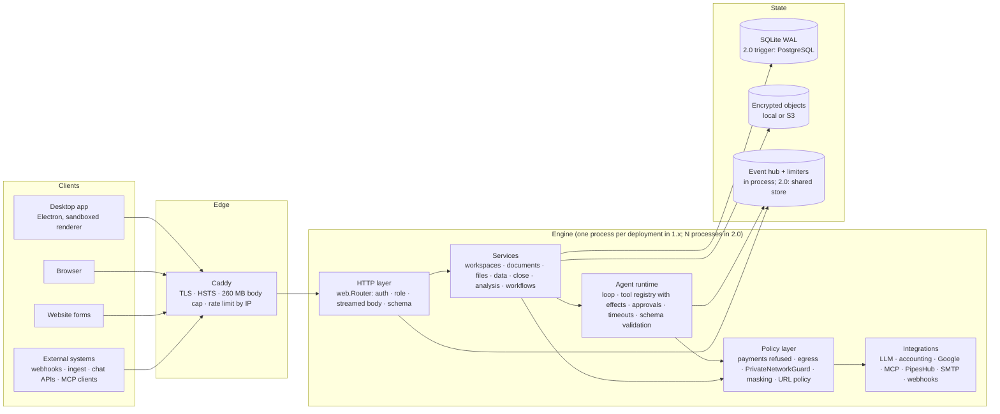

# 07 — Recommended target architecture

The architecture found in document 01 is sound in its bones: one engine for two deployment modes, a thin routing
layer with declarative authorisation, an agent loop the product controls, deterministic calculation engines, and
encryption with established primitives. The recommendation is therefore **evolution, not replacement**: keep the
monolith, make its boundaries explicit, and remove the single-process assumptions only when a measurable need
arrives. No new technology is introduced without a trigger that names it.

## 1. Target (1.x → 2.0)

## 2. Component responsibilities (what changes)

| Component | Today | Target | Why |
|---|---|---|---|
| HTTP layer | `web.Router` with roles, pydantic, streamed bodies | unchanged; add per-key limiter on `/mcp`; shared limiter interface so the backend can be swapped | DoS, horizontal scaling |
| Policy layer | spread across `egress.py`, `security.py`, `Tool.run`, `app.py` | one module boundary (`policy/`) that every outbound call and every tool call passes through; no behaviour change, one place to audit | explicit trust boundary |
| Agent runtime | own loop, effects by label, approvals, timeouts, schema | effects derived from capability declarations (`reads`, `writes_workspace`, `sends_outside`) instead of a free label; approval policy per workspace (which capabilities ask) | OB-08 decision becomes configuration, not code |
| Untrusted content | inserted as text with a prompt rule | wrap every tool result, passage and trigger payload in a fixed delimiter the system prompt names; never concatenate untrusted text into an *instruction* position (workflow agent prompts take `{{trigger.*}}` as a quoted block) | prompt-injection containment (R8 part 2) |
| Integrations | per-provider clients | unchanged; MCP tool lists versioned by schema hash so a changed tool needs re-approval | OB-10 |
| Data | SQLite, datasets inside | unchanged in 1.x; heavy calls off the loop; scheduled checkpoint; encrypted backups | DB-01..03 |
| Events / limiters | in-process | interface + in-process backend in 1.x; Redis backend when N > 1 | horizontal scaling trigger |
| Desktop | Electron with hardening flags | sender-frame check on every IPC channel; signed auto-update with a pinned public key when auto-update ships | OB-12, future update integrity |
| Observability | logs | `/metrics` (Prometheus text) with request latency, run durations, tool timeouts, queue depth; structured logs with request ids | readiness checklist "monitoring" |

## 3. Trust boundaries (unchanged, now explicit)

B0 internet → B1 engine: Caddy + HTTP layer. B1 ↔ B2 untrusted content: delimiter + approval + policy. B1 → B3
outside services: policy layer (URL policy at save and at request, sealing, masking). B4 desktop host: trusts its
user. The target makes B2 and B3 **single modules** so that a reviewer can read the whole boundary.

## 4. Security controls (target state)

| Control | 1.x (after this audit) | 2.0 |
|---|---|---|
| Authentication | scrypt, OIDC/PKCE, sessions with idle + absolute caps | + TOTP, SAML (roadmap), session list and revoke-all in the UI |
| Authorisation | roles per route, membership join | + capability-based approval policy per workspace |
| Secrets | AES-GCM with AAD, master key outside the DB | + key rotation command (re-encrypt under a new key, both keys accepted during rotation) |
| Outbound | save + request-time policy, sealing | + IP pinning in a custom connection pool (closes the last rebinding window) |
| Files | encrypted objects, parser limits | + retention policy and secure delete |
| Backups | plaintext copy | encrypted with an operator-held key (age/GPG), restore rehearsed |
| CI | gitleaks, ruff S, pip-audit, npm audit, Trivy, read-only token | + lockfiles with `npm ci`, SHA-pinned actions, SBOM attached to releases, DAST (ZAP baseline) against a container in CI |
| AI | approval for writes, payments refused, masking, skills gated, 15-case suite | + delimited untrusted text, reviewer-manipulation case, periodic manual evaluation against real models |

## 5. Database design

Keep the schema. Changes: FTS rows deleted with their parents; `secure_delete` on desktop; `secrets.workspace_id`
documented as nullable-for-app-credentials; datasets stay in the main file until the PostgreSQL trigger. See
document 04 §4 for the migration shape when the trigger fires (access layer already database-agnostic;
FTS5 and `ds_*` are the two things that need a design).

## 6. Deployment architecture

- **1.x:** as shipped — Caddy + one engine container (non-root, no capabilities, tmpfs), data volume, optional
  MinIO; sealed variant on an isolated network. Add: encrypted off-host backups on a schedule, `/metrics` scraped by
  the operator's Prometheus, log shipping.
- **2.0 (trigger: a customer needs > 1 engine replica or zero-downtime deploys):** PostgreSQL, Redis (event
  hub, limiters, approval wake-ups), N engine replicas behind Caddy with sticky-less SSE (events read from
  Redis), workflows and agent runs claimed with leases so a replica restart hands them over.

## 7. Authentication and authorisation flow (target)

Unchanged for users: cookie session on the server, per-launch token on the desktop, exact-origin CSRF guard.
Addition: a per-workspace **approval policy** table (`capability → auto | ask | off`) consulted by the agent
runtime instead of the `effect` label; defaults reproduce today's behaviour (`sends_outside` and
`writes_external` ask; `writes_workspace` auto; `reads` auto). This turns the OB-08 owner decision into a setting
an admin can change per workspace and that the audit log records.

## 8. AI execution security model (target)

1. **Input:** user text, attachments, channel messages, workflow triggers — each tagged with its source.
2. **Context:** system prompt (stable + dynamic) + history; every untrusted item wrapped in a named delimiter;
   memories only after approval; skills only after admin enablement.
3. **Model:** masked; provider chosen per workspace; sealed workspaces restricted to local models.
4. **Tool call:** schema validation → capability lookup → policy (payments never; sealed: nothing outside) →
   approval if the capability asks → timeout-bounded execution → audit.
5. **Result:** masked, truncated, delimited, stored.
6. **Answer:** figure check; files resolve every cell to a source; independent reviewer.
7. **Limits:** 16 steps, per-tool timeout, per-run wall clock (add: 20 minutes default).

## 9. Migration roadmap

| Step | Scope | Risk | Depends on |
|---|---|---|---|
| M1 | Policy module extraction (move, don't change) + capability declarations on tools, defaults = today | low | — |
| M2 | Delimited untrusted text; workflow prompts quote trigger data | low–medium (prompt wording; verify with the fake-model suite and a manual evaluation) | M1 |
| M3 | Per-workspace approval policy table + UI; OB-08 defaults applied | low | M1 |
| M4 | Heavy DB calls off the loop; scheduled checkpoint; encrypted backups; `/metrics` | low | — |
| M5 | Lockfiles, SHA-pinned actions, SBOM, ZAP baseline | low | registry access |
| M6 | Key rotation command; retention and secure delete | medium (data migration) | — |
| M7 | Event/limiter interface with in-process backend | low | — |
| M8 | PostgreSQL + Redis backends, multi-replica | high; only on the trigger | M7, document 04 |

Everything through M7 keeps the current deployment shape and user data; M8 is the only step that changes what
an operator runs, and it is gated on a real need.
